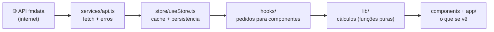
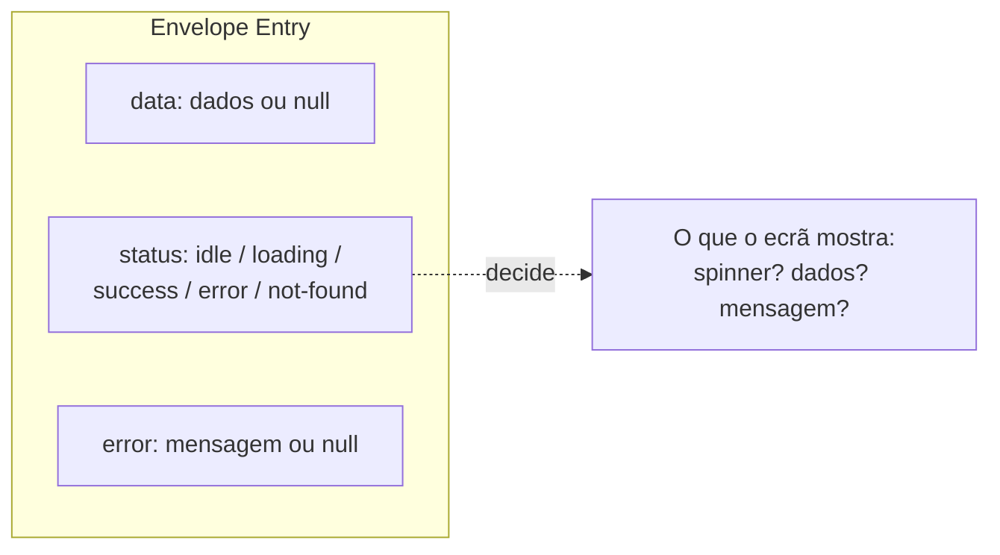
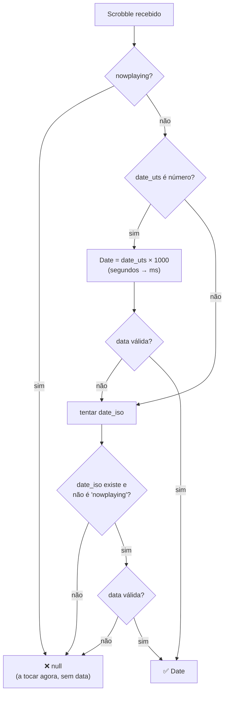
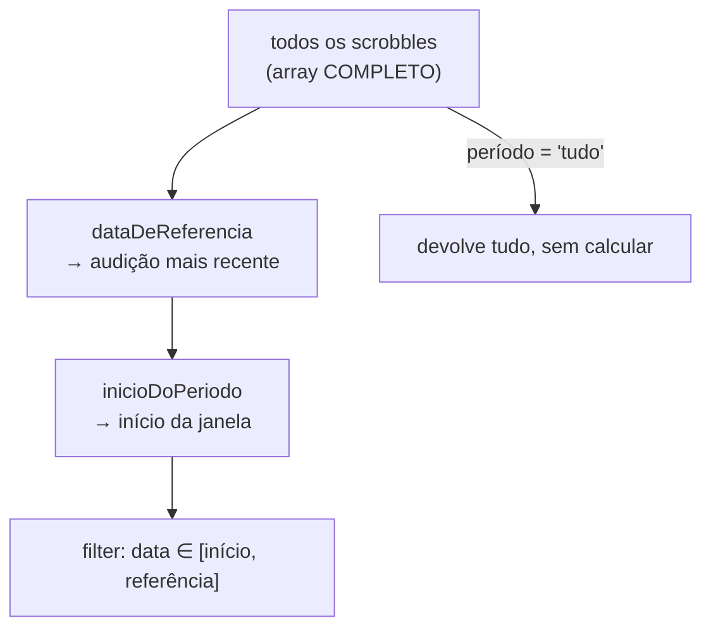
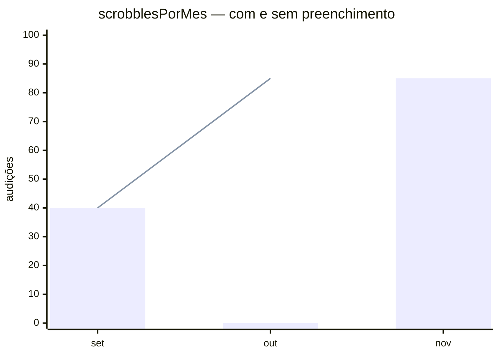
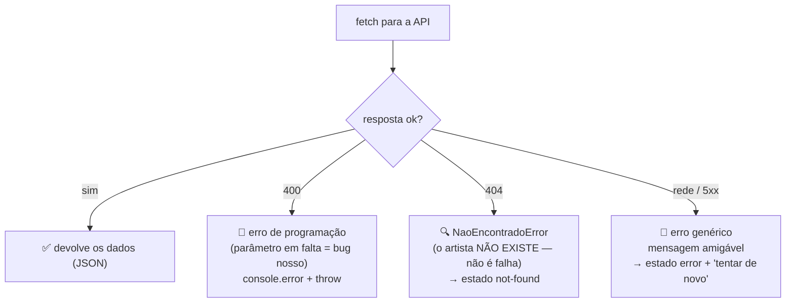
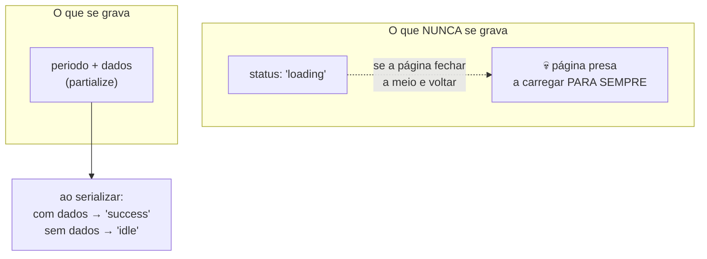
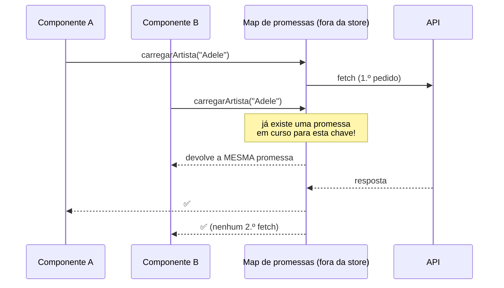
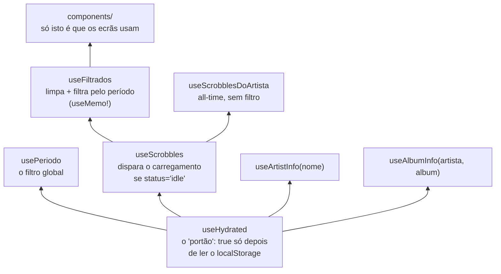
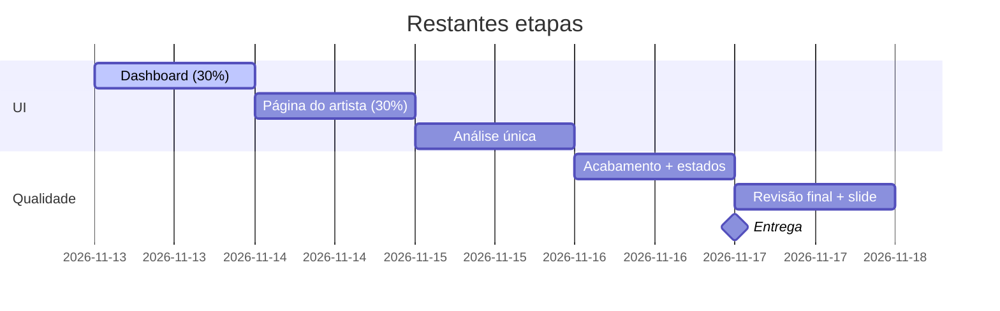

# 📚 Guia de estudo — fmdata-desafio

> Explicação didática de tudo o que foi construído (etapas 1–6 do guia).
> Destinado à partilha com o grupo. Os diagramas em Mermaid renderizam
> como imagens no GitHub, no GitLab e no VS Code (extensão Markdown Preview).

---

## 1. O que é este projeto

Um dashboard que analisa o **histórico de scrobbles do Last.fm** (cada audição
de uma música registada pelo utilizador). A API `fmdata` (`https://fmdata-api.onrender.com`)
fornece os dados, sem autenticação; nós construímos a interface que os transforma
em informação: períodos de escuta, tops, gráficos, perfis de artista.

Construído com **Next.js 16** (App Router) + **TypeScript** + **Zustand** (estado)
+ **Recharts** (gráficos, ainda por usar).

---

## 2. O mapa mental: o pipeline de dados

Todos os dados percorrem sempre o mesmo caminho, da origem ao ecrã.
**São 6 camadas; cada uma só depende da anterior.**



**Porquê esta ordem?**

1. **Funções puras são as mais baratas de testar** — recebem um array, devolvem
   um número. Sem rede, sem React. Apanhamos erros em segundos com um script.
2. **Cada camada só depende da anterior** — se tivéssemos começado pelos
   componentes, íamos inventar dados falsos e refazer tudo quando a API
   mostrasse a realidade.
3. **Os dois ecrãs partilham a base** — o dashboard e a página do artista usam
   as mesmas funções; resolve-se uma vez.

**O "checklist mental" para debugar**, da origem para o fim (nunca ao contrário):

```txt
1. A API devolve o que esperas?   (abrir o URL no browser)
2. Os tipos batem certo?          (comparar um registo com a interface)
3. A função pura acerta?          (testá-la isolada com um array pequeno)
4. A store guarda o que deve?     (inspecionar localStorage / estado)
5. O hook devolve o esperado?     (console.log do retorno)
6. O componente mostra o quê?     (só aqui se olha para o JSX/CSS)
```

---

## 3. Estrutura de pastas e papel de cada uma

```txt
src/
├── types/index.ts        # O "dicionário": a forma de todos os dados
├── lib/                  # ⭐ SÓ FUNÇÕES PURAS — nada de fetch nem React
│   ├── dates.ts          #   datas, horas, períodos
│   ├── filters.ts        #   limpar e filtrar scrobbles
│   ├── stats.ts          #   contagens, rankings, gráfico 24h
│   ├── artist.ts         #   análise por artista
│   └── analise.ts        #   (a análise única — por fazer, etapa 9)
├── services/api.ts       # Os ÚNICOS fetch do projeto + classificação de erros
├── store/useStore.ts     # Estado global + cache + persistência (Zustand)
├── hooks/                # A fronteira entre componentes e dados
├── components/           # (por construir — etapas 7/8 dos colegas)
│   ├── dashboard/
│   ├── artista/
│   └── ui/               # loading, erro, vazio — reutilizáveis
└── app/                  # Rotas do Next.js
    ├── page.tsx          # dashboard (/) — página de verificação
    └── artistas/[nome]/  # página do artista (por construir)
```

A separação `lib/` vs `services/` é **deliberada e avaliada**: `lib/` nunca
pode ter `fetch` — se um cálculo precisar de rede, deixa de ser previsível.

---

## 4. Tipos (`src/types/index.ts`) — o dicionário do projeto

Tudo o que corre no programa passa por estes tipos. Há dois grupos:

### 4.1 Tipos da API — como os dados CHEGAM

```ts
// Uma audição. Atenção aos campos "teimosos":
interface Scrobble {
  track_name: string;      // "Hello"
  artist_name: string;     // "Adele"
  album_name: string;      // "25" — pode ser "" (sem álbum!)
  date_uts: number | null; // timestamp Unix em SEGUNDOS — null se agora
  date_iso: string | null; // "2026-11-08T01:08:41.000Z" — alternativa
  tags: string;            // "pop, soul" — TEXTO com vírgulas, não array!
  loved: 0 | 1;            // favorita? (união de uma linha → type ideal)
  image_url: string | null;// capa — pode faltar
  nowplaying: boolean;     // "a tocar agora" → nunca tem data
}
```

Os pormenores que definem as regras de todo o resto:

| Campo | Armadilha | Consequência no código |
|---|---|---|
| `date_uts: number \| null` | `null` quando "a tocar agora" | `parseDataScrobble` devolve `null`; filtros descartam |
| `date_uts` em segundos | `new Date(s)` sem `* 1000` dá datas de 1970 | multiplicamos por 1000 |
| `tags` é texto | `"rock, indie"` não é array | `separarLista()` divide e limpa |
| `loved: 0 \| 1` | contar audições ≠ contar faixas | favoritas contam-se como faixas distintas |
| `album_name: ""` | scrobbles sem álbum existem | `topAlbuns`/`albunsDoArtista` ignoram-nos |

### 4.2 Tipos do domínio — como os dados são PROCESSADOS

O mais importante é o **`Entry<T>`** — o "envelope" universal:

```ts
interface Entry<T> {
  data: T | null;        // o conteúdo (Scrobble[], ArtistInfo, …)
  status: Status;        // "idle" | "loading" | "success" | "error" | "not-found"
  error: string | null;  // mensagem amigável quando falha
  updatedAt: number | null; // quando foi a última sincronização
}
```

**Porquê?** Sem o envelope, cada componente teria o seu `isLoading`, o seu
`error`, a sua lógica. Com o envelope, **todos os dados da rede têm sempre a
mesma forma** — um scrobble, um artista ou um álbum são tratados do mesmo
jeito nos hooks e nos componentes.



Outros tipos do domínio:

| Tipo | Papel | Exemplo |
|---|---|---|
| `Periodo` | união dos 5 filtros do dashboard | `"tudo" \| "30d" \| "14d" \| "7d" \| "24h"` |
| `ItemRanking` | linha de qualquer top | `{ chave: "adele", nome: "Adele", contagem: 31, imagem: "…" }` |
| `PontoMensal` | ponto do gráfico por mês | `{ mes: "2026-11", contagem: 84 }` |
| `ArtistaSemelhante` | similar da API + se já o ouveste | `{ nome: "Sam Smith", ouvido: true }` |

**Regra de estilo TypeScript:** `interface` para formas de objeto;
`type` só para uniões de uma linha (como `Periodo` e `Status`).

---

## 5. `lib/dates.ts` — o problema mais traiçoeiro: datas

**Porque foi o primeiro ficheiro?** Porque tudo (períodos, gráfico 24h, por mês)
depende de datas — e as datas do Last.fm são inconsistentes.

### `parseDataScrobble(scrobble): Date | null`

Converte um scrobble numa data fiável, ou `null` se não a tiver.



Ordem de preferência: **`date_uts` primeiro** (é um número, sem ambiguidade
de formato), `date_iso` como alternativa. Note-se o `× 1000`: o Last.fm dá
segundos, o JavaScript quer milissegundos.

### `dataDeReferencia(scrobbles): Date | null`

Devolve a **data da audição mais recente**. É a âncora de todos os períodos.

> 💡 **O insight mais importante do projeto:** "últimas 24 horas" **não conta
> a partir de agora** — conta a partir da reprodução mais recente.
> Se o utilizador não ouviu música nas últimas 48 h, o período "24h" devolve
> uma amostra real do dia em que ouviu música, **não** um dashboard vazio.

### `duracaoDoPeriodoMs(periodo)` e `inicioDoPeriodo(periodo, referencia)`

```txt
"24h" → 24 × 3600 × 1000 ms        inicioDoPeriodo("7d", ref)
"7d"  → 7 × 24 × … ms                  = ref − duração
"tudo" → null (sem limite)             = uma Date, o "início da janela"
```

Tudo numa **tabela única** (`duracaoDoPeriodoMs`): se um dia quisermos
acrescentar "90d", só se mexe nessa função.

### `horaUTC(data): number`

Devolve `getUTCHours()` (0–23). **Porquê UTC e não hora local?** Porque o
enunciado do gráfico 24h é em UTC, e porque o endpoint da API
`/stats/listening-clock` também é. Usar hora local desalinhava os nossos
números dos números oficiais.

### `chaveDoMes(data): string`

Devolve `"2026-11"`. O truque: uma chave de texto assim **ordena-se
cronologicamente por ordem alfabética** — sem precisar de lógica de datas.

### `formatarData(data)` e `formatarMes(chave)`

Apresentação: `"12 mar 2026"`, `"mar 2026"`. Estão separadas das funções
de cálculo porque **formatar é apresentação, não lógica**.

---

## 6. `lib/filters.ts` — limpar e filtrar

### `normalizarNome("  Beyoncé ")` → `"beyonce"`

`trim` + minúsculas + **remoção de acentos** (via `normalize("NFD")`, que
separa o acento do carácter, e um `replace` que o elimina).

> É a base de TODAS as comparações por nome. Sem ela, `"Adele" ≠ "adele "`
> e um artista apareceria duas vezes nos tops. Perde-se a acentuação
> apenas *internamente* — o nome mostrado no ecrã é sempre o original.

### `separarLista("rock, indie , ,pop")` → `["rock", "indie", "pop"]`

Divide, corta espaços e descarta vazios. É **a função mais reutilizada do
projeto**: serve para `tags` e `similar_artists` (vírgula) e para
`tracklist_names` (ponto e vírgula — `"Faixa A; Faixa B"`). Por isso foi
feita genérica com o separador como parâmetro.

### `removerSemData(scrobbles)`

Descarta `nowplaying` e audições sem data. Chama-se **antes de qualquer
cálculo temporal** — uma audição sem data não pode entrar num gráfico de
horas ou num período.

### `filtrarPorPeriodo(scrobbles, periodo)`



**O pormenor que se esquece:** a referência calcula-se sobre o array
**completo**, nunca sobre o já filtrado. Se fosse sobre o filtrado, o resultado
mudaria a cada aplicação do filtro ("deslizaria").

### `filtrarPorArtista(scrobbles, nome)`

Compara com `normalizarNome` dos dois lados. É o portão da página do artista.

---

## 7. `lib/stats.ts` — contagens e rankings

### O motor: `contarPor` + `paraRanking`

Quase todos os tops são a mesma coisa: **contar chaves e ordenar**.

```ts
// contarPor: um Map chave → ocorrências
contarPor(scrobbles, (s) => normalizarNome(s.artist_name))
// Map { "adele" => 31, "sam smith" => 12, … }

// paraRanking: ordena (maior → menor) e corta no limite
paraRanking(contagens, 20) // → ItemRanking[]
```

**Dois pormenores de qualidade:**

1. **Desempate alfabético** — sem ele, duas músicas com contagens iguais
   trocam de posição a cada render e a lista "salta".
2. **Chaves vazias não contam** (`if (k === "") continue`) — protege os
   scrobbles sem álbum, por exemplo.

### Os três tops e a "chave composta"

```txt
topArtistas(n=20) → chave = nome do artista
topMusicas(n=10)  → chave = "artista::faixa"   ← nunca só a faixa!
topAlbuns(n=8)    → chave = "artista::álbum"
```

> 💡 **Porquê a chave composta nas músicas?** Porque duas músicas com o
> mesmo título de artistas diferentes **não são a mesma música**
> ("Hello" da Adele ≠ "Hello" dos Oasis). O subtítulo (artista) e a capa
> guardam-se no `ItemRanking` para o ecrã.

Para mostrar o **nome original** (com acentos e caixa corretas) em vez do
normalizado, um helper `exemplosDe()` procura uma ocorrência real de cada
chave — escrito **uma vez** e reutilizado nos quatro rankings (revisão
ponytail eliminou 4 cópias).

### `scrobblesPorHora(scrobbles): number[]` — sempre 24 posições

```txt
[0, 3, 7, 12, 5, 0, … , 2]   ← 24 posições, de 0h a 23h UTC
```

Devolve **sempre** as 24 posições, com `0` nas horas sem audições.
O gráfico precisa das 24 barras **mesmo quando há buracos** — se devolvesse
só as horas com dados, o eixo desalinhava da realidade.

### `horaDePico(porHora): number | null`

O índice com o valor mais alto (para a barra destacada no gráfico).
`null` se tudo for zero — caso de um período sem audições.

### `generoMaisOuvido(scrobbles)`

Cada audição contribui para **todas** as suas tags (não só a primeira),
com caixa normalizada: `"Rock"` e `"rock"` contam juntas.

---

## 8. `lib/artist.ts` — análise por artista

Todas as funções recebem os scrobbles **já filtrados por artista**.

| Função | O que devolve | Pormenor que importa |
|---|---|---|
| `artistaExiste` | boolean | decide a página "não encontrado" |
| `resumoDoArtista` | total, %, favoritas, 1.ª e última | **favoritas = faixas distintas** (ouviste "Hello" 50× com loved=1 → 1 faixa favorita, não 50); `%` evita divisão por zero |
| `topMusicasDoArtista` | ranking de faixas | reutiliza `contarPor` + `paraRanking` + `exemplosDe` |
| `albunsDoArtista` | álbuns com **faixas distintas ouvidas** | o "Y" de "Ouviste X de **Y** faixas" **não vem daqui** — vem de `AlbumInfo.track_count` (a API); o componente combina os dois |
| `scrobblesPorMes` | pontos cronológicos | **preenche meses vazios com 0** entre o primeiro e o último |
| `ultimasAudicoes(n)` | as n mais recentes | ordena desc, ignora sem data |
| `artistasSemelhantes` | lista + flag `ouvido` | cruza a API com os nossos scrobbles; **só os ouvidos ficam clicáveis** |

> 💡 **Porquê preencher os meses vazios?** Sem isso, o gráfico "salta" de
> março direto para junho e **mente** sobre a evolução: um vale (0 audições)
> e um buraco (mês ausente) são coisas muito diferentes.



*A barra (correta) mostra o vale de outubro; a linha (errada) liga outubro
direto a novembro — é assim que o gráfico fica sem o preenchimento.*

E uma nota de reutilização: o "relógio 24h" do artista **não tem função
própria** — é a mesma `scrobblesPorHora` aplicada aos scrobbles do artista.
Não se escreve lógica duas vezes.

---

## 9. `services/api.ts` — os pedidos e a classificação de erros

Só existem 3 funções de rede no projeto: `obterScrobbles`, `obterArtistInfo`
(usa `encodeURIComponent` nos nomes — espaços e acentos!), `obterAlbumInfo`.

Toda a classificação de erros acontece **uma única vez**, no helper `pedir()`:



**A distinção 404 vs rede é uma decisão de design, não de sorte:** "o artista
não existe" merece uma **página própria calma**; "a rede falhou" merece um
**botão de tentar de novo**. Se as duas coisas forem o mesmo erro, o
utilizador culpa-se por algo que não fez.

---

## 10. `store/useStore.ts` — o coração: cache, persistência, deduplicação

A store resolve **4 problemas de uma vez**:

### Problema 1 — Estado global
O `periodo` ("tudo"/"30d"/…) vive aqui, e **todo o dashboard reage à mesma
escolha** — não há cópias dessincronizadas em componentes.

### Problema 2 — Cache
Cada resposta da rede guarda-se num `Entry<T>` por chave:

```txt
scrobbles  → 1 entrada só                    (o histórico completo)
artistas   → Record[nome normalizado]        (1 por artista visitado)
albuns     → Record["artista::album"]        (1 por álbum visitado)
```

Antes de pedir: se a entrada já está `success` **com dados, não se pede
outra vez**. Resultado: navegar dashboard → artista → dashboard não repete
o pedido pesado de `/scrobbles`.

### Problema 3 — Persistência (`localStorage`)

O middleware `persist` grava a cache — sobrevive ao refresh (F5) sem
novos pedidos. Mas há **duas armadilhas graves** que o código evita:



E o **`skipHydration: true`**: o servidor do Next renderiza **sem**
`localStorage`; se a store se hidratasse logo no primeiro render, o HTML do
servidor e o do cliente difeririam → **erro de hidratação**. A reidratação é
**manual**, no cliente, feita pelo hook `useHydrated` (ver §11).

### Problema 4 — Deduplicação



O registo de pedidos em curso (`Map<string, Promise>`) vive **fora da store**
— é infraestrutura, não estado. Quando a promessa termina, remove-se.

---

## 11. `hooks/` — a fronteira entre componentes e dados

**Princípio:** os componentes **nunca** tocam na store nem no `fetch`.
Falam só com hooks — cada um com **uma** responsabilidade:



### `useHydrated()` — a peça que evita o erro clássico do Next

1. No servidor, renderiza com `false` (a store ainda não foi lida).
2. No cliente, num `useEffect`, chama `persist.rehydrate()` **uma única vez**
   (um `Promise` ao nível do módulo garante isso, mesmo que 10 componentes
   usem o hook).
3. Devolve `true` → só **agora** é seguro decidir "não tenho dados, vou pedir".

Sem isto: pedidos desnecessários + erro de hidratação na consola.

### `useScrobbles()` — dados com carregamento automático

```txt
hidratado && status === "idle"  →  carregarScrobbles()  (1 vez)
status === "success"            →  não faz nada (cache!)
```

**Pormenor de qualidade:** quando ainda não há dados, devolve um **array
vazio constante** (`const VAZIO = []`), nunca um `[]` novo a cada render —
um `[]` novo invalidaria os `useMemo` de tudo o que está a jusante.

### `useFiltrados()` — o hook que o dashboard inteiro consome

Junta `useScrobbles` + `usePeriodo` e aplica `removerSemData` +
`filtrarPorPeriodo` **dentro de `useMemo([todos, periodo])`**.
Sem o `useMemo`, refiltaríamos milhares de registos **a cada render**.

### `useArtistInfo(nome)` / `useAlbumInfo(artista, album)`

Leem a cache por chave normalizada, disparam o carregamento se `idle`,
e mapeiam: `404 → status "not-found"` (não `"error"`). O `useAlbumInfo` é
**opcional por design**: se falhar para um álbum, a UI degrada com elegância
("X faixas ouvidas") em vez de partir a página.

---

## 12. `app/` — as rotas

- `layout.tsx` — raiz, `lang="pt"`, fontes, metadata.
- `page.tsx` — **página de verificação** da fundação: seletor de período +
  contador. O "pronto quando" da etapa 6: a contagem muda ao mudar o
  período. Na etapa 7 é substituída pelo dashboard real.
- `artistas/page.tsx` — placeholder temporário (a navegação real far-se-á
  pelo top 20 do dashboard).

---

## 13. Testes (`scripts/teste-lib.ts`)

25 verificações correm contra a **amostra real de 100 scrobbles**
(`scrobbles-amostra.json`) — não contra dados inventados:

```bash
npx tsx scripts/teste-lib.ts
```

O que valida, por camada:

| Grupo | Verificações |
|---|---|
| dates | `nowplaying` → `null`; array vazio → `null`; referência existe |
| filters | `separarLista` com espaços e vazios; acentos; `removerSemData`; "24h" ⊂ "tudo" |
| stats | 24 posições **sempre**; soma das horas = total; tops ≤ limite; subtítulo (artista) nas músicas |
| artist | resumo coerente (% entre 0 e 100); meses contíguos (sem saltos); semelhante ouvido/não-ouvido; faixas distintas ≤ audições |

**Podes correr tu mesmo** — é a forma mais rápida de confiar no código.

---

## 14. Números reais (da amostra, para fixar ideias)

```
100 scrobbles na amostra
Adele: 31 audições → 31,3% do total (resumoDoArtista)
primeira: 2 nov 2026 · última: 8 nov 2026
1 registo é nowplaying (sem data) → excluído dos cálculos temporais
0 faixas com loved=1 na amostra → favoritas = 0
```

---

## 15. Glossário de defesa (perguntas prováveis na apresentação)

| Pergunta | Resposta em 15 segundos |
|---|---|
| **"Porquê separar `lib/`?"** | Funções puras sem rede nem React são previsíveis e testáveis — 25 testes correm em segundos sem servidor. Os componentes só recebem resultados. |
| **"Como evitam pedidos repetidos?"** | Cache por chave na store (`Entry` com `success` não volta a pedir) + Map de promessas em curso fora da store para deduplicação em tempo real. |
| **"O que acontece se a API falhar?"** | Cada pedido é classificado uma vez: 404 → página "não encontrado"; rede → mensagem amigável + "tentar de novo"; e a cache antiga (persistida) permite continuar a navegar com dados de antes. |
| **"Porquê UTC?"** | O gráfico 24h e a API são em UTC; usar hora local desalinha os números. |
| **"O que é o `Entry<T>`?"** | O envelope padrão de qualquer dado da rede — todos os hooks e blocos lidam com `data/status/error` da mesma forma. |
| **"Porque é que '24h' pode não estar vazio?"** | Conta a partir da audição mais recente (`dataDeReferencia`), não de agora. |

---

## 16. Estado atual e próximo capítulo (a cargo dos colegas)

**Feito (etapas 1–6):** projeto + skills, exploração da API, tipos, as 4
bibliotecas de funções puras (testadas), camada de pedidos, store Zustand
com cache/persistência/deduplicação, os 7 hooks, página de verificação.
Tudo verde: TypeScript ✓ · Biome ✓ · 25/25 testes ✓.

**Por fazer (etapas 7–12):** dashboard, página do artista, análise única,
estados/polimento, revisão final, slide + demo. O caminho está aberto:
os componentes só precisam de consumir `useFiltrados()` / `useScrobblesDoArtista()`
e as funções puras — **toda a lógica já existe e está testada**.



---

*Documento gerado para estudo do grupo. O código comentado nas fontes
(`src/`) complementa este guia — cada decisão "porquê" está anotada
junto do código.*
